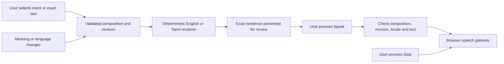

# WorldSpeak — your context, your meaning, your voice

**Live demo: [https://worldspeak-akilanpl.vercel.app](https://worldspeak-akilanpl.vercel.app)** · [current release evidence](docs/WORLDSPEAK_FINAL_MASTER_AUDIT.md) · [submission package](docs/WORLDSPEAK_FINAL_SUBMISSION.md)

WorldSpeak turns explicitly chosen communication intent into deterministic English/Tamil sentences. Review exact words, then deliberately press Speak; Stop remains available. Object selection, model output, replay and language changes never authorize speech. A prepared essential board works offline without sign-in.

[Engineering documentation](docs/README.md)

## Communication architecture

WorldSpeak separates selecting meaning, rendering words and authorizing speech. A typed composition holds an intent, locale, catalog version and revision. The immutable reducer increments that revision when meaning or language changes. Deterministic templates render structured requests, polarity and object slots; exact user-entered text is preserved rather than rewritten or translated. Unknown objects and missing slots fail explicitly.



The [approval module](packages/communication/src/approval.ts) binds a speech permit to composition ID, revision, locale and rendered-text tag. The [speech gateway](apps/web/src/lib/speech.ts) validates the current sentence inside the trusted Speak handler. The FNV text tag is a deterministic integrity check, not a cryptographic authentication primitive. Changing a tile, replaying content or receiving a model response cannot grant speech authority. Browser voice availability and pronunciation require separate device acceptance; Tamil remains native-review pending.

## Offline and persisted data

[The offline builder](scripts/build-offline.mjs) packages the essential board for prepared, sign-in-free use. It contains public communication assets rather than a cache of private account data. Shared communication logic and parity tests keep its review/Speak behavior aligned with the application. Prepare it online once, then use `/offline/index.html`; private synchronization still depends on connectivity and authenticated access.

The Next.js application uses Supabase Auth, PostgreSQL and private storage for account-owned records. [Versioned migrations](supabase/migrations/) enforce row-level ownership and relational checks rather than trusting a client-supplied owner ID. Worker/provider contracts keep inference requests separate from the deterministic communication path. Inference remains disabled in the documented release; its budget/ticket machinery does not itself authorize model execution.

| Component | Responsibility and inspection entry point |
|---|---|
| [packages/contracts/](packages/contracts/) | Typed, validated communication and inference contracts |
| [packages/catalog/](packages/catalog/) | Catalog objects, localized nouns and versioned templates |
| [packages/communication/](packages/communication/) | Immutable composition, rendering and speech permits |
| [apps/web/](apps/web/) | Selection/review UI, browser speech, offline entry and account routes |
| [apps/worker/](apps/worker/) · [packages/inference/](packages/inference/) | Separate inference execution and provider contracts |

## Verification and release evidence

Reducer/approval, rendering, speech-gateway, offline-parity and browser tests exercise the communication boundary. These functional checks establish authorization behavior; they do not establish clinical effectiveness, translation quality or successful real-model execution. The receipts below preserve the actual deployment, synthetic-fixture and account acceptance distinctions.

Deployed runtime baseline `3e4f92135023dbff006b1f6d44f6cd85a4414a3c` has [passing main CI](https://github.com/akilanpl/worldspeak/actions/runs/41609632027) and a READY production deployment with nine-route HTTP smoke passing. The deployed safe Auth rejection guidance was independently observed; this is not a successful login test. [Portable deployment receipt](docs/evidence/final-deployment-2026-11-03.json). Later documentation-only main commits do not change this runtime. The guest demo below retains historical source `7030dbf`.

Local video is manual frame/region selection; personal pictograms are human-chosen images held in page memory. One real historical Spark generation succeeded, its original persistence failed, and JSONB persistence was repaired/tested. SAM masks and model/browser fixtures remain explicitly synthetic/reconstructed. No real SAM generation, automatic model tracking, Muse Image, Voice Transcribe, open-weight inference or fine-tuning success is claimed.

All nine Supabase migrations are hosted in dedicated `cafkyowssdemzivhzxbb`; [read-only lineage/types/security evidence](docs/evidence/hosted-reconciliation-2026-11-03.json) preserves SQL hashes and historical 4402 micro-USD. Inference remains disabled; tickets/budgets are not authorized by this release. Auth origin/callbacks are configured, but owner Google selection still returned to Sign In; real account/inbox acceptance remains open and the cause is unproven. The deployed Auth change supplies safe diagnostics, not a proven login repair. Native Tamil and physical phones/screen reader/audio remain explicit gates.

A **122.72-second silent, captioned guest demo candidate** completed in [capture CI 41607185098](https://github.com/akilanpl/worldspeak/actions/runs/41607185098). Its storyboard and hashes were reviewed; [portable receipt](docs/evidence/guest-demo-2026-11-03.json) records source `7030dbf`, no observed forbidden requests and no public video URL. It is not yet an approved final portal asset; publication and final submission require owner approval. Silent footage does not establish native audio, Tamil pronunciation or physical-device acceptance.

## Run locally

Node 22 and pnpm 10.18.0:

```sh
pnpm install --frozen-lockfile
pnpm lint
pnpm typecheck
pnpm test
pnpm check:schema
pnpm build
pnpm test:e2e
pnpm check:secrets
pnpm dev
```

Unconfigured accounts fail closed; guest mode never fakes a session. Prepare once online, then open `/offline/index.html`. Tamil remains review-pending. `pnpm test:db` is destructive and strictly local scratch-only: never aim it at hosted Supabase.

[Acceptance matrix](docs/WORLDSPEAK_FEATURE_ACCEPTANCE_MATRIX.md) · [security/privacy](docs/WORLDSPEAK_SECURITY_AND_PRIVACY_REPORT.md) · [deployment receipt](docs/WORLDSPEAK_DEPLOYMENT_RECEIPT.md) · [accessibility](docs/WORLDSPEAK_ACCESSIBILITY_ACCEPTANCE.md) · [model evidence](docs/WORLDSPEAK_MODEL_VALIDATION.md) · [remaining gates](docs/WORLDSPEAK_CONTINUATION_BLOCKERS.md) · [MIT license](LICENSE).

Documentation basis: [`97ebc49`](https://github.com/akilanpl/worldspeak/tree/97ebc498429f3fa86d48ca03ba47ff4154c3041d). Recorded validation retains its original source and environment scope.
